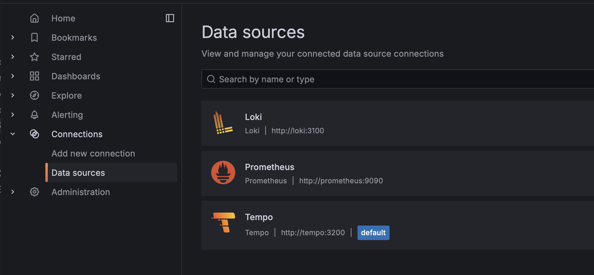
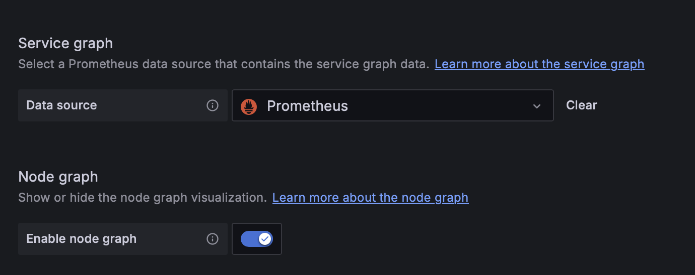
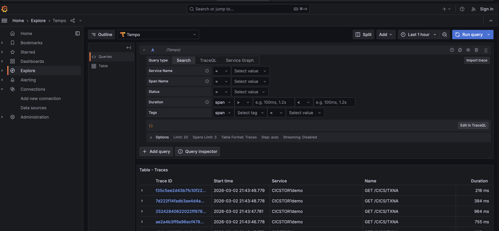
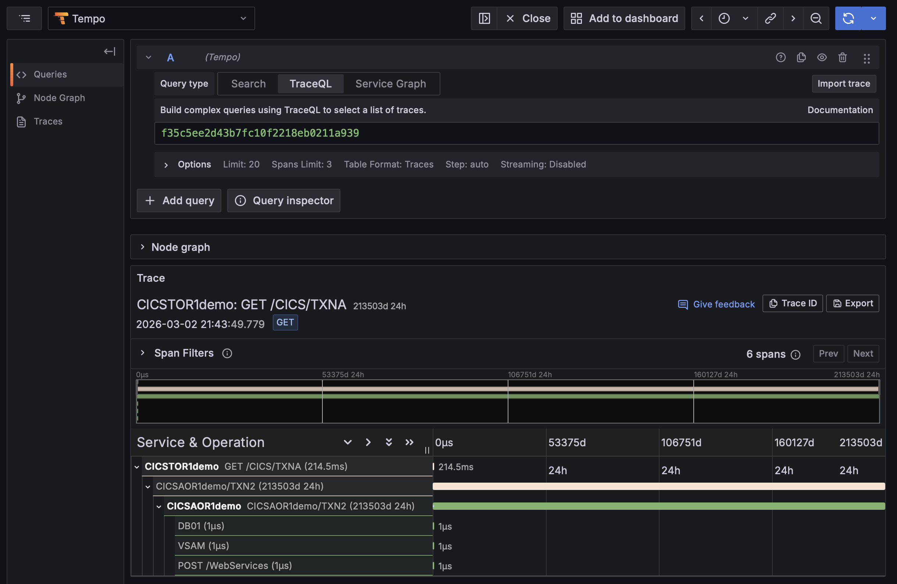
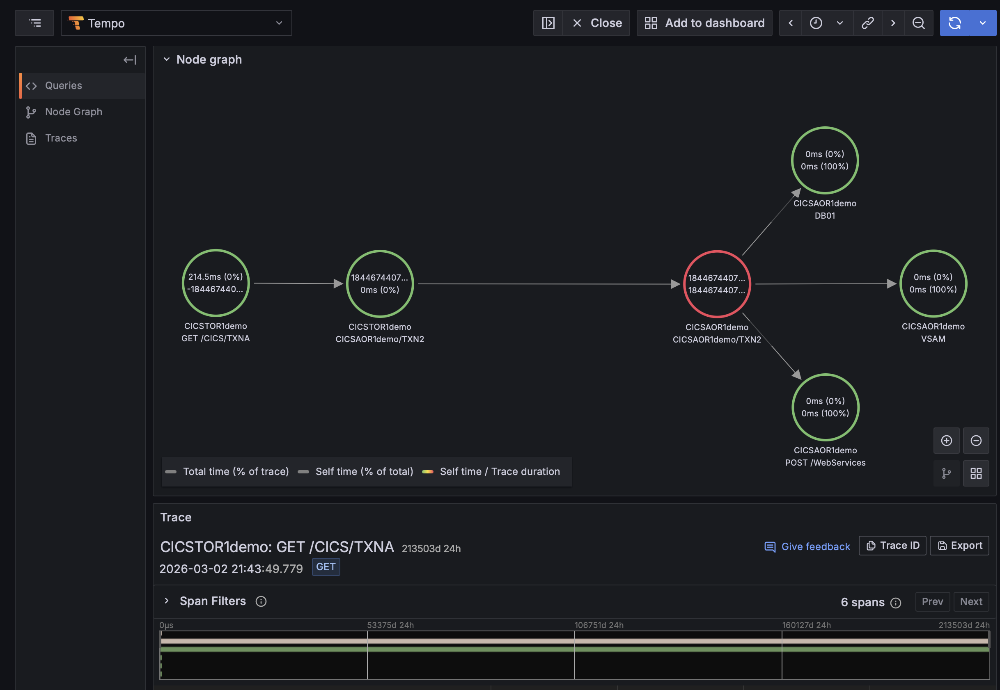
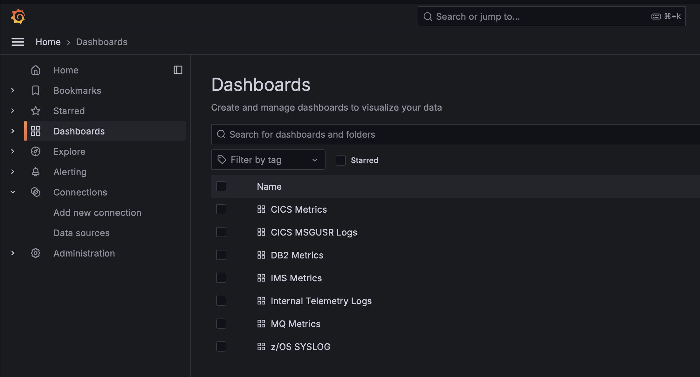
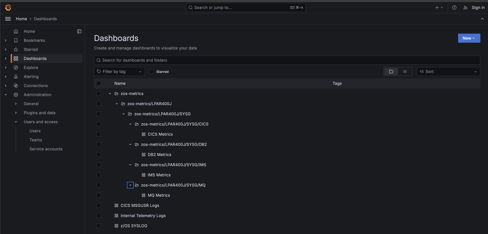
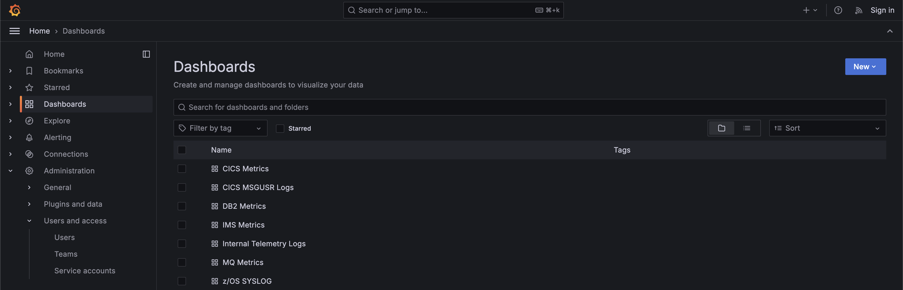

# ZOC Telemetry Controller Grafana Dashboards

Sample Grafana dashboards are provided to help visualize and validate telemetry generated by the Z Observability Connect (ZOC) Telemetry Controller. These dashboards serve as examples and as a starting point for exploring the z/OS metrics and log data available through ZOC.

## Table of Contents

- [Dashboard Overview](#dashboard-overview)
- [Scenario 1: Deploy Grafana Stack (Grafana, Loki, Tempo, Prometheus, and ZOC Dashboards)](#scenario-1-deploy-grafana-stack-grafana-loki-tempo-prometheus-and-zoc-dashboards)
  - [Prerequisites](#prerequisites)
  - [Deployment](#deployment)
    - [1. Clone repository](#1-clone-repository)
    - [2. Deploy the Grafana stack](#2-deploy-the-grafana-stack)
    - [3. Update Telemetry Controller to Send Metrics, Traces and Logs](#3-update-telemetry-controller-to-send-metrics-traces-and-logs)
    - [4. Access Grafana](#4-access-grafana)
    - [5. Set Up Node Graph and Service Graph](#5-set-up-node-graph-and-service-graph)
    - [6. View Traces](#6-view-traces)
    - [7. View Sample Dashboards for Metrics and Logs](#7-view-sample-dashboards-for-metrics-and-logs)
    - [8. (Optional) Enable Dynamic Dashboard Mode](#8-optional-enable-dynamic-dashboard-mode)
- [Telemetry Controller Dashboards](#telemetry-controller-dashboards) *(requires Fix Pack 26.8.0+)*
  - [Telemetry Controller Health](#telemetry-controller-health)
  - [ZTC Span Metrics](#ztc-span-metrics)
  - [Per-Pod Identity in the Health Dashboard](#per-pod-identity-in-the-health-dashboard)

---

## Dashboard Overview

- **CICS / DB2 / MQ / IMS Metrics dashboards** — z/OS subsystem operational metrics
- **ZTC Health Metrics — OTel Collector Operations** — internal health and performance of the Telemetry Controller collector pods *(requires Fix Pack 26.8.0+)*
- **ZTC Span Metrics** — z/OS workload span rates and error metrics derived from distributed traces *(requires Fix Pack 26.8.0+)*

> **Note:** The **ZTC Health Metrics** and **ZTC Span Metrics** dashboards require **ZOC Telemetry Controller Fix Pack 26.8.0 or later**. They will not populate with data on earlier Fix Pack versions.

To view these dashboards, several prerequisites must be in place, including Grafana, Prometheus, Tempo, and Loki. The instructions below outline two possible scenarios, depending on whether you already have these prerequisites in place.

For either scenario, you should first install the ZOC Telemetry Controller and Common Data Provider, configured with the ZOC metrics and logs policy. For reference on deploying Telemetry Controller or CDP metrics and log policies, refer to [Z Observability Connect documentation](https://www.ibm.com/docs/en/zapmc/7.1.0?topic=telemetry-controller).

---

## Scenario 1: Deploy Grafana Stack (Grafana, Loki, Tempo, Prometheus, and ZOC Dashboards)

Use this scenario if you do not already have an existing Grafana stack. It guides you through deploying Grafana, Loki, Tempo, and Prometheus along with the ZOC dashboards.

### Prerequisites

A docker-compose.yaml file is included in this repository that contains deployment definitions for Grafana, Loki, and Prometheus. Using it requires either Docker Compose or Podman Compose to be available on your system.

Refer to these links for guidance on deploying Docker or Podman with Compose:

- [Docker](https://docs.docker.com/engine/install/)
- [Podman](https://developers.redhat.com/blog/2018/08/29/intro-to-podman#)
- [podman-compose](https://github.com/containers/podman-compose)

### Deployment

#### 1. Clone repository
```bash
git clone https://github.com/IBM/z-observability-connect.git
```

#### 2. Deploy the Grafana stack

Before running this step, ensure you are in the `z-observability-connect/grafana-dashboards` directory, as Docker or Podman will need access to `z-observability-connect/grafana-dashboards/docker-compose.yaml`.

Docker:
```bash
docker compose up -d
```

Podman:
```bash
podman-compose up -d
```

#### 3. Update Telemetry Controller to Send Metrics, Traces and Logs

Now that your Grafana stack is ready, configure the ZOC Telemetry Controller to export metrics, traces and logs to it. This is done by updating `telemetry-controller/config/exporters.yaml` (telemetryctl) or `values.yaml` (Helm).

For metrics, update the `prometheus_remote_write` exporter endpoint to point to your Prometheus instance. Replace `<prometheus-fqdn>` and `<port>` with the FQDN and remote write port of your Prometheus instance (default port `9090`):

```yaml
prometheus_remote_write:
  endpoint: "http://<prometheus-fqdn>:<port>/api/v1/write"
  tls:
    insecure: true
  resource_to_telemetry_conversion:
    enabled: true
  add_metric_suffixes: true
```

For logs, uncomment the `otlphttp` section and update the endpoint `http://<loki-backend>:3100/otlp`. The value for `<loki-backend>` should be the fully qualified domain name (FQDN) of the machine where the Grafana stack is deployed.

For traces, add an `otlp/tempo` exporter block to configure traces to export to Tempo in the Grafana stack. `<tempo-vm-endpoint>` is the FQDN of the machine where you deployed the Grafana stack. Port `4317` is the default gRPC port exposed by Tempo.

- **telemetryctl** — add the following to `telemetry-controller/config/exporters.yaml`:

```yaml
otlp/tempo:
    pipelines: ["traces"]
    endpoint: "http://<tempo-vm-endpoint>:4317"
    tls:
      insecure: true
```

- **Helm** — add the equivalent block under `otelcollector.config.exporters` in `values.yaml`:

```yaml
otelcollector:
  config:
    exporters:
      otlp/tempo:
        endpoint: "http://<tempo-vm-endpoint>:4317"
        tls:
          insecure: true
    service:
      pipelines:
        traces:
          exporters:
            - otlp/tempo
```

**IMPORTANT:** After updating the configuration, you will need to redeploy the Telemetry Controller:

- **telemetryctl:**
  * `./telemetryctl stop`
  * `./telemetryctl install`

- **Helm:**
  * `helm upgrade <release-name> <chart-path> -f values.yaml -n <namespace>`

You must apply the full configuration update for the changes to take effect.

#### 4. Access Grafana

To access the Grafana UI, point your browser to `http://<fqdn>:3000`. The FQDN is the fully qualified hostname of the machine Grafana is deployed on. 

#### 5. Set Up Node Graph and Service Graph

To enable Node Graph and Service Graph views for trace, navigate to the Grafana UI: `http://<fqdn>:3000`. 

On the lefthand panel, go to `Connection`->`Data Sources`. 



Click on `Tempo`, then scroll down to `Additional settings`. 



Under Service graph, update the `Data Source` to be `Prometheus` and toggle `Enable node graph` to be enabled.

Scroll to the bottom of the page and select `Save & test`.

#### 6. View Traces

Click `Explore` and then select the 'Search' tab. 



Click on a trace. 



Open the `Node graph` section which is located above `Trace`. 



#### 7. View Sample Dashboards for Metrics and Logs

To view the sample dashboards for Metrics & Logs, navigate to `Dashboards`.



#### 8. (Optional) Enable Dynamic Dashboard Mode

By default, the Grafana stack deploys with **static dashboards** - pre-configured dashboards that display all subsystems. For advanced users who want automatic dashboard organization by SYSPLEX/SYSTEM/SUBSYSTEM hierarchy, you can optionally enable **dynamic dashboard mode**.

**What is Dynamic Dashboard Mode?**

Dynamic mode automatically:
- Discovers z/OS subsystems from Prometheus metrics
- Creates hierarchical folder structure: `zos-metrics → SYSPLEX → SYSTEM → SUBSYSTEM`
- Generates type-specific dashboards for CICS, DB2, MQ, and IMS
- Monitors for new subsystems and creates dashboards automatically
- Organizes dashboards by your z/OS topology

**Dashboard Mode Comparison:**

| Feature | Static Mode (Default) | Dynamic Mode (Optional) |
|---------|----------------------|------------------------|
| Setup | Simple (docker-compose) | Requires API key + config |
| Organization | Flat list | Hierarchical (SYSPLEX/SYSTEM/SUBSYSTEM) |
| Subsystem Discovery | Manual | Automatic |
| Dashboard Updates | Manual | Automatic |
| Best For | Quick start, simple environments | Large environments, organized topology |

**Prerequisites for Dynamic Mode:**
- Grafana stack must be running (steps 1-7 above)
- Grafana API key with Admin role
- `jq` command-line tool installed (version 1.5+)
- `bash` version 4.0+ (for associative arrays)

**Enable Dynamic Dashboards:**

1. **Install jq** (if not already installed):
   ```bash
   # On RHEL/CentOS
   sudo yum install -y jq
   
   # On Ubuntu/Debian
   sudo apt-get install -y jq
   
   # Verify installation
   jq --version
   ```

2. **Generate Grafana API Key**:
   - Login to Grafana (http://localhost:3000)
   - Go to **Administration** → **Service Accounts**
   - Click **Add service account**
   - Name: `auto-dashboard-script`, Role: **Admin** (Editor role is insufficient)
   - Click **Add service account token**
   - Copy the generated token

3. **Configure dynamic dashboard settings**:
   ```bash
   # From the grafana directory
   vi config.env
   ```
   
   Update these settings:
   ```bash
   GRAFANA_URL=http://localhost:3000
   GRAFANA_API_KEY=<your-api-key-here>
   PROM_URL=http://localhost:9090
   CHECK_INTERVAL=10  # How often to check for new subsystems (seconds)
   ```

4. **Apply dynamic dashboards**:
   ```bash
   chmod +x apply-dynamic-dashboards.sh remove-dynamic-dashboards.sh dynamic-dashboards-status.sh
   ./apply-dynamic-dashboards.sh

   example:
      [root@sk-isl21 dynamic-dashboard]# ./apply-dynamic-dashboards.sh
      [2026-06-04 06:04:30] Loading configuration from /root/monitoring/dynamic-dashboard/config.env
      [2026-06-04 06:04:30] Validating Grafana connectivity...
      [2026-06-04 06:04:30] Validating Grafana API key...
      [2026-06-04 06:04:31] Validating Prometheus connectivity...
      [2026-06-04 06:04:31] Starting dynamic dashboard mode...
      [2026-06-04 06:04:31] Deleting static dashboards from Grafana...
      [2026-06-04 06:04:31] Updated DYNAMIC_MODE=true in config.env
      [2026-06-04 06:04:31] ✓ Dynamic mode started (PID: 3077083)
      [2026-06-04 06:04:31]   Log file: /root/monitoring/dynamic-dashboard/auto-sync.log
      [2026-06-04 06:04:31]   Use './dynamic-dashboards-status.sh' to check status
      [2026-06-04 06:04:31]   Use './remove-dynamic-dashboards.sh' to switch back to static mode
   ```
   
   This will:
   - Remove static dashboards from Grafana
   - Create dynamic dashboards organized by SYSPLEX → SYSTEM → SUBSYSTEM
   - Start background process to continuously monitor for new subsystems
   - Log output to `auto-sync.log`

5. **Check status**:
   ```bash
   ./dynamic-dashboards-status.sh

   example:
      [root@sk-isl21 dynamic-dashboard]# ./dynamic-dashboards-status.sh
      [2026-06-04 06:01:23] Loading configuration from /root/monitoring/dynamic-dashboard/config.env
      =========================================
      Grafana Dashboard Mode Status
      =========================================
      Current Mode: false

      Dynamic Sync Process: Not running
      =========================================
      [root@sk-isl21 dynamic-dashboard]#

   ```

   
   Output shows:
   - Current mode (static or dynamic)
   - Background process status
   - Number of deployed dashboards

6. **View logs** (optional):
   ```bash
   tail -f auto-sync.log
   ```

7. **Remove dynamic dashboards and switch back to static mode** (if needed):
   ```bash
   ./remove-dynamic-dashboards.sh

   example:
      [root@sk-isl21 dynamic-dashboard]# ./remove-dynamic-dashboards.sh
      [2026-06-04 06:11:49] Loading configuration from /root/monitoring/dynamic-dashboard/config.env
      [2026-06-04 06:11:49] Stopping dynamic dashboard mode...
      [2026-06-04 06:11:49]   ✓ Stopped background process (PID: 3077083)
      [2026-06-04 06:11:49] Deleting dynamic dashboards from Grafana...
      [2026-06-04 06:11:50]   ✓ Deleted dynamic dashboard folder: zos-metrics
      [2026-06-04 06:11:50]   ✓ Cleaned up state file
      [2026-06-04 06:11:50] Updated DYNAMIC_MODE=false in config.env
      [2026-06-04 06:11:50] ✓ Switched back to static dashboard mode
      [2026-06-04 06:11:50]   Static dashboards will be re-provisioned automatically
      [2026-06-04 06:11:50]   If they don't appear, restart Grafana: docker-compose restart grafana
   ```
   
   This will:
   - Stop the background monitoring process
   - Remove all dynamic dashboards from Grafana
   - Restore static dashboards (requires Grafana restart: `docker-compose restart grafana`)

**Important Notes:**

- **Mode Switching**: You can switch between static and dynamic modes at any time without losing data
- **Single Dashboard Source**: Both modes use the same dashboard templates from the `/dashboards` folder
- **Automatic Conversion**: The script automatically converts static dashboards to dynamic format when needed
- **Background Process**: Dynamic mode runs continuously in the background to discover new subsystems
- **State Management**: The script tracks deployed dashboards to avoid duplicates

**Troubleshooting:**

- If dashboards don't appear after switching modes, restart Grafana: `docker-compose restart grafana`
- Check logs for errors: `tail -100 auto-sync.log`
- Verify API key has Admin role (Editor role lacks folder creation permissions)
- Ensure Prometheus has z/OS metrics with required labels: `zos_sysplex`, `service_namespace`, `service_name`, `zos_smf_id`

**Example Dynamic Dashboard Hierarchy:**

```
zos-metrics/
└── LPAR400J/              # SYSPLEX
    └── SYSG/              # SYSTEM
        ├── CICS/          # Subsystem Type
        │   ├── CICSR01E   # Individual Dashboard
        │   └── CICSR02E
        ├── DB2/
        │   ├── DC1E
        │   └── DC1K
        ├── MQ/
        │   └── M31A
        └── IMS/
            └── IMS1
```



**Example Static Dashboard Hierarchy:**
```
├── CICS Metrics dashboard
├── DB2 Metrics dashboard
├── IMS Metrics dashboard
├── MQ Metrics dashboard
```




---

## Telemetry Controller Dashboards

> The dashboards in this section (**ZTC Health Metrics** and **ZTC Span Metrics**) require **ZOC Telemetry Controller Fix Pack 26.8.0 or later**. They will not populate with data with earlier Fix Pack versions.

In addition to the subsystem metric dashboards (CICS, DB2, MQ, IMS), two dashboards are provided to monitor the Telemetry Controller itself and the z/OS workload it is processing.

### Telemetry Controller Health

**File:** `ztc-health-metrics.json`

Monitors the internal health and performance of the OTel Collector instances running inside the Telemetry Controller. Use this dashboard to answer: *"Is the collector running correctly and processing data without errors?"*

The dashboard is organised into the following sections:

- **Telemetry Controller Health Overview** — At-a-glance stat panels for Active Collectors, Span Acceptance Rate, and Export Success Rate. Active Collectors should match your expected pod count; acceptance and export rates should remain at 100%.
- **Data Ingestion by Signal Type** — Ingestion rate and distribution across traces, metrics, and logs. Useful for confirming which signal types are actively flowing through the collector.
- **Receiver Health** — Accepted vs refused spans per receiver, and total spans by receiver. Refused spans greater than zero indicates backpressure or a receiver misconfiguration. Values are shown in spans/sec.
- **Exporter Health** — Sent vs failed spans and queue size per exporter. A growing queue or failed spans indicates the downstream backend is slow or unreachable.
- **Processor Performance** — Processors run in series in the order defined in the pipeline. The dashboard includes sample panels for `memory_limiter` and `batch`; if additional processors are configured, queries need to be updated accordingly. `memory_limiter` refused greater than zero means the collector is under memory pressure and actively dropping data. `batch` flush activity is normal and expected.
- **Resource Utilization** — Memory (RSS and heap) and CPU usage per collector pod. By default each pod is identified by its `service_instance_id` (a UUID). To show human-readable pod names (e.g. `otel-collector-0`, `otel-collector-1`) in the legend, add a `pod` label to the `prometheus/health` receiver scrape config. See [Per-Pod Identity in the Health Dashboard](#per-pod-identity-in-the-health-dashboard) below.

**How health metrics reach Prometheus:**

The collector exposes its own internal metrics on port `8888` in Prometheus exposition format. The `prometheus/health` receiver in the pipeline scrapes this port on loopback (`127.0.0.1:8888`) — a self-scrape that never leaves the pod. The collected metrics are then forwarded to Prometheus via the `prometheus_remote_write` exporter. Port `8888` is exposed only as a `ClusterIP` service within the cluster and is not accessible externally.

**Prerequisites:**

- The `prometheus/health` receiver and `prometheus_remote_write` exporter must both be enabled in the Telemetry Controller pipeline configuration. This is the default in Fix Pack 26.8.0 and later.
- To display pod names instead of UUIDs in the Resource Utilization panels, add a `pod` label to the `prometheus/health` receiver `static_configs`. See [Per-Pod Identity in the Health Dashboard](#per-pod-identity-in-the-health-dashboard) below.
- Grafana connected to Prometheus as a data source.

---

### ZTC Span Metrics 

**File:** `ztc-span-metrics.json`

Visualises the z/OS telemetry data being processed by the Telemetry Controller, specifically span metrics derived from distributed traces. Use this dashboard to answer: *"What z/OS workload is the Telemetry Controller observing, and at what rate?"*

The dashboard is organised into the following sections:

- **Overview** — Active SYSPLEX, LPAR, and service counts alongside a current span rate gauge. Provides a quick summary of how many z/OS systems are actively sending data.
- **Volume Analysis** — Span rate over time by LPAR and SYSPLEX, with last-week comparison lines. Useful for detecting workload changes or drops in data flow.
- **Span Rate by Subsystem** — One line per subsystem type (CICS, DB2, MQ, IMS) showing the aggregated span rate. 
- **Span Rate by Services** — One line per individual service (region instance). Use the **Service** dropdown to filter and drill down into specific services.
- **Span Distribution** — Proportional breakdown of traffic by SYSPLEX, LPAR, and service via pie and bar charts.
- **Current Subsystem Rate** — Gauge panels per subsystem type showing the current point-in-time span rate.
- **Error Metrics** — Error rate percentage by subsystem and over time by service. A non-zero error rate on a specific service indicates failing z/OS transactions; cross-reference with traces in Tempo for root cause analysis.

**Prerequisites:**

- The `spanmetrics` connector must be enabled in the Telemetry Controller pipeline configuration and its output pipeline must use the `prometheus_remote_write` exporter to push span-derived metrics to Prometheus.
- The following span dimensions must be configured in the `spanmetrics` connector:
  - `tps.system` (CICS)
  - `db.system.name` (DB2)
  - `messaging.system` (MQ)
  - `ibm.ims.processing_ims` (IMS)
  - `mainframe.lpar.name`
  - `zos.sysplex.name`
- Active z/OS workload sending traces through the Telemetry Controller.

---

### Per-Pod Identity in the Health Dashboard

By default the **Resource Utilization** panels (Memory RSS, Heap Allocated, CPU Usage) identify each collector pod by its `service_instance_id`, which is a UUID generated at startup. This can be hard to map to the pod name.

To display human-readable pod names (e.g. `otel-collector-0`, `otel-collector-1`) in the legend, add a `pod` label directly to the `prometheus/health` receiver's `static_configs` in your `values.yaml`. The Telemetry Controller StatefulSet already injects the pod name as the `POD_NAME` environment variable, so the value is available at runtime.

**How to configure:**

In your `values.yaml` (Helm) or equivalent OTel Collector config, update the `prometheus/health` receiver to include the `pod` label under `static_configs`:

```yaml
prometheus/health:
  config:
    scrape_configs:
      - job_name: otelcol
        scrape_interval: 10s
        static_configs:
          - targets: ["127.0.0.1:8888"]
            labels:
              pod: ${env:POD_NAME}
```

The `${env:POD_NAME}` syntax resolves the `POD_NAME` environment variable at collector startup. With `resource_to_telemetry_conversion: enabled: true` already set on the `prometheus_remote_write` exporter (the default), the `pod` label is written to Prometheus on every scraped metric and appears in the dashboard legend as the pod name.

> **Note:** Pod names follow the StatefulSet naming convention: `otel-collector-0`, `otel-collector-1`, etc. (or `otel-col-tier1-0`, `otel-col-tier1-1` when the two-tier topology is enabled). Without this label, all panels continue to work correctly — only the legend shows UUIDs with no pod name.
